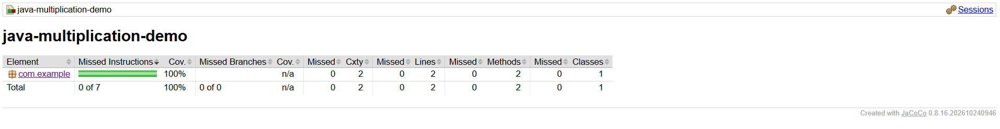

# DevOps

**BRANCHING STRATEGY**

The project follows a simplidfied GitFlow-inspired feature-branch workflow to organise development, testing, documentation, and releases. The main branch serves as the primary integration branch, containing completed changes merged through pull requests. The release branch is maintained for stable versions of the project.Development is performed on short-lived branches created from main some examples are:

feature/* – Implements new functionality, such as feature/multiplication.

test/* – Adds and improves unit tests, such as test/multiplication-tests.

docs/* – Updates project documentation.

Every task is tracked using Github issues and proper commit-style messages are used for any changes in the project. When development is completed the short-lived branch is pushed to GitHub and a pull request is created against main. The pull request is linked to the issue, in that way any changes that will be commited can be reviewed before the final merge. After the merge is completed the short-lived branch is deleted to keep the repository more organized. Git retains the merge and pull history for reviewing. Eventually the stable changes of the main branch are realesed to the release branch. The most stark difference between my branching strategy and traditional GitFlow is that my strategy does not use a permanent develop branch. Instead, development branches merge directly into main, reducing complexity while retaining branch isolation, traceability, and controlled integration.

Automated Testing with GitHub Actions

Implemented GitHub Actions to automate the execution of the projects JUnit 5 test suite. A YAML workflow file with the path .github/workflows/maven-tests.yml, was created to configure Java 17 and then execute the Maven test command mvn clean test. The workflow is triggered automatically when a pull request targets the main branch or any changes are pushed to main. The first two workflow executions are recorded:

Workflow #1: Executed when pull request #9 was opened.

Workflow #2: Executed after pull request #9 was merged into main.

Both workflows run successfully and in this way continuous integration is implemented and changes are automatically verified through unit testing before and after any integration in the main branch. 

Code Coverage (JaCoCo)

Code coverage is measured using the JaCoCo Maven plugin (version 0.8.16).

mvn clean verify was used in the command prompt then i used the target/site/jacoco/index.html command to get the report.

Both JUnit 5 tests passed sccessfully with no failures or errors. Because the multiplication class does not contain any conditional branches the branch coverage is not applicable. 